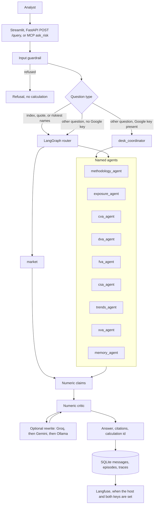
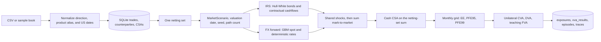
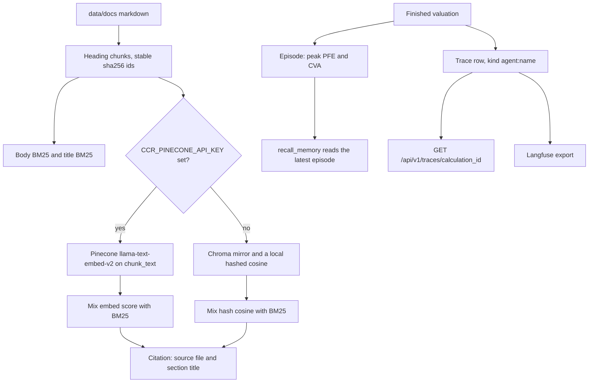

# Architecture

## Problem statement

A counterparty-credit analyst needs a number they can defend: if this name defaults, how large is the loss, and what does the collateral agreement change? Expected exposure, potential future exposure, and CVA are pathwise calculations. A chat model can describe them and still invent the figure. A risk report cannot use that figure.

The book is small and local: USD interest rate swaps, USD-settled FX forwards, and a cash collateral agreement. The analyst also asks ordinary questions around that book, such as what the last calculation was, which stored name has the largest unilateral CVA, what the methodology note says, and where a published index closed. Those answers have to stay tied to a source.

v0.1 does not produce SA-CCR or IMM capital, does not stream a live rate curve into the valuation, and does not price European options.

## Solution

`desk_coordinator` chooses one named agent and may rephrase the finished sentence. QuantLib and a NumPy Monte Carlo engine produce every exposure and XVA number. SQLite produces every remembered number. A methodology note or a Yahoo Finance quote produces every retrieved number. The numeric critic withholds the sentence when it contains any other number.

Three doors share that path. Streamlit is the desk. FastAPI is the HTTP API. The stdio MCP server `ccr-xva` exposes the same engines to Cursor. Google ADK coordinates the specialists when `CCR_GOOGLE_API_KEY` is set. Market questions and book-ranking questions skip ADK and use the LangGraph router, which is also the path when no Google key is set.

## Dataflow

### A question

The router nodes are `guard_input`, `planner`, `execute`, `critic`, and `guard_output`. `desk_coordinator` does not calculate. It delegates to `methodology_agent`, `exposure_agent`, `cva_agent`, `dva_agent`, `fva_agent`, `csa_agent`, `trends_agent`, `xva_agent`, and `memory_agent`. `market` is router-only: index quotes and the riskiest-name ranking never go through `desk_coordinator`. Ranking, snapshot comparison, and volatility sensitivity stay on the router. SQLite records the handoff as `agent:` plus the short catalog name.

| Question | Agent name | Tool | Where the number comes from |
| --- | --- | --- | --- |
| Peak PFE or EE | `exposure_agent` | `peak_pfe` | Monte Carlo profile |
| Exposure chart | `trends_agent` | `graph_trends` | Monte Carlo profile |
| Unilateral CVA | `cva_agent` | `calculate_cva` | XVA engine |
| Riskiest stored names | router owner `cva` | book ranked by unilateral CVA | XVA engine. This question skips `desk_coordinator`. |
| DVA | `dva_agent` | `calculate_dva` | Same XVA result |
| Teaching FVA | `fva_agent` | `calculate_fva` | Same XVA result |
| CVA, DVA, and FVA together, or a collateral what-if | `xva_agent` | `approximate_xva`, `what_if_cva` | Same XVA result |
| CSA terms | `csa_agent` | `read_csa` | Stored collateral row |
| Last calculation, compare two snapshots | `memory_agent` | `recall_memory` | Latest SQLite episodes |
| Methodology wording | `methodology_agent` | `search_methodology` | Retrieved note, cited by file and section |
| Live index or single-name quote | `market` | Yahoo Finance chart API | Yahoo quote |
| Refusal | `desk` | none | Guardrail text |

### A valuation

IRS trades are revalued on each path with Hull-White discount bonds and the contractual fixed and floating cashflows. FX forwards are revalued from a GBM spot and deterministic rates. Collateral is applied to the netting-set sum. The same shocks are shared inside a netting set. A non-USD valuation currency or an unsupported product raises before pricing, so a mixed netting set is refused rather than silently dropping a trade.

`POST /api/v1/calculate/exposure` and `POST /api/v1/calculate/xva` write those rows directly. A chat question that needs a number calls the same service and then stores the episode the memory agent can read later.

### Notes, memory, and traces

With a Pinecone key, Chroma is not written. The mix is body BM25 0.45, title BM25 0.15, and the Pinecone score 0.40. Without a key the mix is body BM25 0.60, title BM25 0.25, and hashed cosine 0.15, plus a Chroma rank boost. If Pinecone sync or search raises, retrieval keeps the local score.

SQLite holds counterparties, trades, CSAs, exposure profiles, XVA results, episodes, session messages, and traces. `recall_memory` quotes the latest episode. A compare question uses two stored exposure snapshots. Market quotes are not saved as episodes. `GET /api/v1/traces/{calculation_id}` reads the local trace. `POST /api/v1/eval/run` runs the short suite against this same code.

## Why these tools

| Tool | Job | Why this one |
| --- | --- | --- |
| QuantLib | IRS schedule and discount-bond checks | The Monte Carlo swap can be compared with a library a rates desk already trusts. |
| NumPy | Hull-White and FX paths | Thousands of paths are array work. A laptop can finish a desk question without a separate pricing grid. |
| LangGraph | Offline router | The guard, planner, tool, and critic are explicit nodes. Tests can run them with no model key. |
| Google ADK | Multi-agent coordinator | `desk_coordinator` delegates to `methodology_agent`, `exposure_agent`, `cva_agent`, `dva_agent`, `fva_agent`, `csa_agent`, `trends_agent`, `xva_agent`, and `memory_agent`. A failed ADK run falls back to the router. Model: `gemini-2.5-flash`. |
| Groq, Google Gemini, Ollama | Sentence rewrite | Groq (`llama-3.1-8b-instant`) is the hosted first try. Gemini (`gemini-2.5-flash`) is the second. Ollama (`llama3.1:8b`) is the local model. The critic drops a rewrite that adds a number. |
| rank-bm25 | Methodology ranking | The corpus is a handful of headed notes. A lexical score finds the CVA section without an embedding account. |
| Chroma | Local chunk mirror | The index lives in `data/chroma` and starts with the API. No vector service is required. |
| Pinecone | Hosted embeddings | `llama-text-embed-v2` embeds `chunk_text` on upsert and on search when `CCR_PINECONE_API_KEY` is set. The desk still answers from the local chunk text. |
| SQLite and SQLAlchemy | Book, memory, traces | One file, `data/ccr_xva.db`, is opened by the API and by the MCP server. A calculation remains after Langfuse is down. |
| Langfuse | Trace review | The optional `obs` profile gives a UI for the same handoffs already stored as `agent:` rows. |
| Yahoo Finance chart API | Live index and equity quotes | The quote is a claim with source `yahoo:{symbol}`. It is labeled as a market level and is not an input to CVA. |
| FastAPI | HTTP API | Upload, valuation, query, memory, traces, and eval are typed routes with OpenAPI at `/docs`. |
| Streamlit and Plotly | Desk UI | Upload, exposure, XVA what-if, chat, and the public check page stay in one Python app. Plotly draws EE and PFE. |
| MCP | Cursor tools | `list_agents`, `recall_memory`, `search_methodology`, `list_book`, `load_sample_book`, `calculate_exposure`, `calculate_xva`, and `ask_risk` call the same functions as the API. |

`methodology_agent` calls `search_methodology`. `exposure_agent` calls `peak_pfe`. `cva_agent` calls `calculate_cva`. `dva_agent` calls `calculate_dva`. `fva_agent` calls `calculate_fva`. `csa_agent` calls `read_csa`. `trends_agent` calls `graph_trends`. `xva_agent` calls `approximate_xva` and `what_if_cva`. `memory_agent` calls `recall_memory`. `market` reads Yahoo directly and has no ADK name. `desk` is the catalog name of `desk_coordinator` and has no calculation tool.

## Options to improve

**Make a repeated number identical.** Each new valuation draws paths again, so peak PFE can move slightly between runs. Store the seed and the path count on the episode, and let a recall return that stored profile instead of inviting a fresh simulation.

**Prove the hosted index.** Health currently reports `embeddings: pinecone` when the key string is non-empty. A health check that lists the index, or a documented BM25-only fallback in the UI, would show whether `llama-text-embed-v2` actually answered.

**Score the prose, not only the formula.** `scripts/run_eval.py` already records the FX check: closed form 312,342.32 USD, Monte Carlo 312,322.85 USD, relative error 0.000062. RAGAS faithfulness is still a laptop run. Add it before quoting how often a rewrite stays inside the claims.

**Price from a curve, and keep quotes in their lane.** The scenario uses a flat USD rate. A saved discount curve, checked in QuantLib, would replace that flat input. Yahoo levels should remain a market answer and stay out of the Monte Carlo.

**Fill the typed gaps.** `src/ccr_xva/engines/extensions.py` already names European option pricing, a revaluation surrogate, and a wrong-way-risk flag. Securities collateral and multi-currency CSAs are the matching collateral gaps. Each of those should fail closed, as unsupported products do today, until the engine owns the number.

**Put a capital view beside the engine.** A later SA-CCR or IMM screen can cite the regulatory formula. It should sit next to EE and PFE and should not replace them.

**Protect a shared desk.** The SQLite file is one local book with no login. A published URL needs an account boundary, a per-user session, and a way to turn off Groq, Gemini, and Pinecone spend. A named Cloudflare tunnel, or the existing Docker Compose ports on a trusted host, is the deployment shape. The quick tunnel is only a demo.
